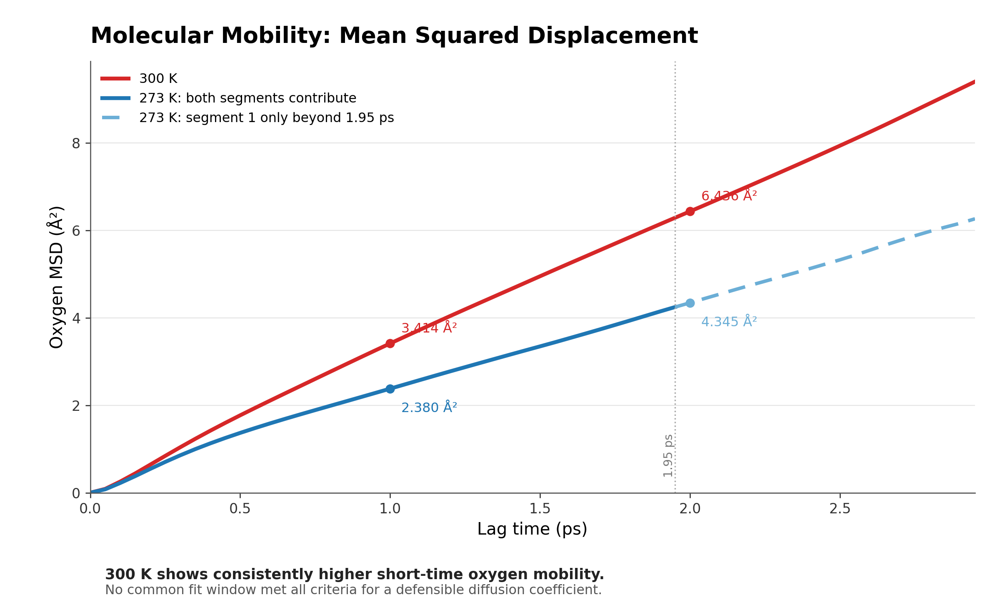

# Molecular Dynamics of TIP3P Water

An undergraduate chemistry research internship project by **Youssef Ahmed** at Westlake University, supervised by Prof. Yiqin Gao and Dr. Manas Mondal. Using SPONGE/Xponge, I built and validated a periodic box of 862 TIP3P water molecules, then compared short, matched production trajectories targeting 300 K and 273 K.

## Read or present the work

- [Final research report (PDF)](report/MD_Research_Experiment_Report.pdf) — 24 pages, including the methods, analysis, and limitations.
- [Presentation (PDF)](presentation/MD_Research_Experiment_Presentation.pdf) — 75 slides.
- [Editable presentation (PowerPoint)](presentation/MD_Research_Experiment_Presentation.pptx).
- [Audit and provenance notes](AUDIT.md).

## Results in the sampled trajectories

| Measure | 300 K target | 273 K target |
| --- | ---: | ---: |
| Sampled temperature | 301.79 ± 5.30 K (100 records) | 269.96 ± 4.76 K (99 records) |
| Density | 0.976319 ± 0.001366 g/cm³ | 0.976066 ± 0.000786 g/cm³ |
| Geometric hydrogen bonds per frame | 1108.70 ± 17.00 | 1195.86 ± 17.19 |
| Mean tetrahedral order parameter | 0.5617 | 0.5908 |
| Oxygen MSD at 1 ps | 3.414 Ų | 2.380 Ų |

The cooler branch showed a more populated geometric hydrogen-bond network, modestly greater local tetrahedral order, and lower **short-time** oxygen mobility in these trajectories. The two branches share a simulation lineage, production is only about 5 ps per branch, and neighboring frames are correlated. These observations are descriptive; they do not establish a converged bulk diffusion coefficient, independent temperature-effect uncertainty, an ice transition, or rigorous equilibrium. One 273 K thermodynamic record was lost at a restart and was not reconstructed.



*The 273 K curve beyond 1.95 ps uses only the first continuous production segment. See the report for the analysis and sensitivity checks.*

## Repository contents

| Path | Contents |
| --- | --- |
| [`report/`](report/) | Final report PDF supplied in the final report folder |
| [`presentation/`](presentation/) | PDF and editable PowerPoint versions of the final presentation |
| [`evidence/`](evidence/) | Frozen accepted evidence package: experiment inputs and outputs, analyses, figures, methods, provenance, and per-file SHA-256 manifest |
| [`scripts/verify_package.py`](scripts/verify_package.py) | Portable integrity check for the packaged evidence and published documents |

The evidence package is copied byte-for-byte from the accepted 22 September 2026 assembly; only its enclosing directory was shortened from `FINAL_TIP3P_WATER_300K_273K_PROJECT_PACKAGE_COMPLETE` to `evidence` to keep Windows paths manageable. Its internal names and provenance records remain unchanged, including historical Windows paths. Earlier repair branches, local environments, downloaded software, and duplicate ZIP archives are omitted from this public repository.

## Check the published files

With Python 3.9 or newer, run:

```bash
python scripts/verify_package.py
```

This checks the 451 manifest entries against the actual package files, sizes, and SHA-256 hashes, plus the three report/presentation artifacts. It checks integrity, not scientific reproducibility. The historical SPONGE runs and full analysis were **not rerun** for this publication; some retained scripts document the original Windows environment and require adaptation for a new machine. Start with the package's [`FINAL_PROJECT_SUMMARY.md`](evidence/00_PROJECT_OVERVIEW/FINAL_PROJECT_SUMMARY.md), [`FINAL_METHODS.md`](evidence/04_REPRODUCIBILITY/FINAL_METHODS.md), and [`LIMITATIONS.md`](evidence/04_REPRODUCIBILITY/LIMITATIONS.md) before using the raw trajectories.
